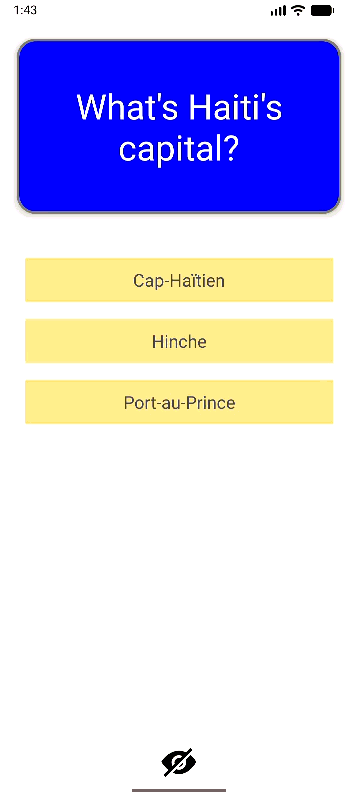

# Flashcard App
📝 `NOTE` Paste this template at the top of your existing `README.md` file from the last lab.

## Lab 4

### App Description
`TODO://` Add app description

### App Walk-though
`TODO://` Add the URL to your animated app walk-though `gif` in the image tag below. Make sure the gif actually renders and animates when viewing this README. (☝️ Remove this paragraph after after adding gif)

 

`TODO://` In the User stories section below, add an `x` between the `-[ ]` like this `- [x]` for any user story you complete. (☝️ Remove this paragraph after after checking off user stories)

## Required
- [x] User sees a transition animation when going from the main screen to the add card screen.
- [x] User sees a reveal animation when the flashcard is tapped and the answer is shown
- [x] User sees flashcards animating in / out when the 'next' button is tapped

## Optional
- [x] Extra styling is added!
- [ ] User sees a countdown timer for each question
- [ ] User sees a 'card flip' animation when the card is tapped
- [ ] User sees a celebration animation with confetti when they answer a question correctly

## Lab 1 - Flashcard App

### App Description
An interactive Android flashcard application that allows users to view a flashcard question, tap to reveal the answer, test their knowledge with selectable multiple-choice options, and toggle the visibility of the answer choices.

### User Stories

#### Required Features
- [x] Create New Project in Android Studio
- [x] Add a view for the front side of the flashcard to display the question
- [x] Add a view for the back side of the flashcard to display the answer
- [x] Build in logic to toggle the flashcard between the question side and the answer side

#### Optional Features
- [x] Style the question and answer side of the card to better distinguish between the two sides
- [x] Further customize and style the card
- [x] Add selectable multiple choice answers beneath the card
- [x] Change the background color of the multiple choice answers when clicked to indicate whether the question was answered correctly
- [x] Add a button that will toggle hiding and showing the answer choices

---

### App Walkthrough
